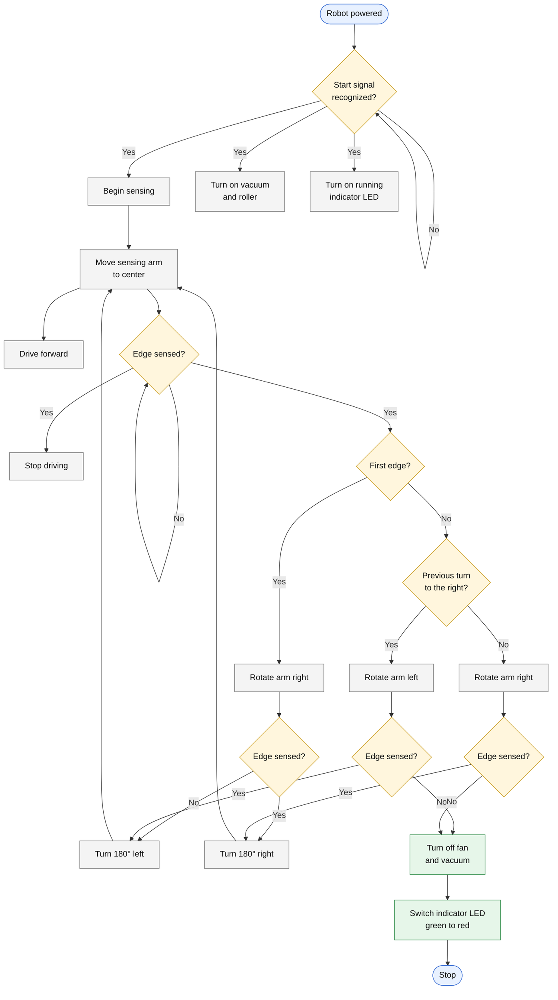
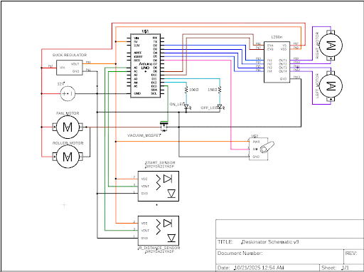

# Deskinator

An autonomous desk-cleaning robot built for **EK 210 (Fall 2025, Section A4, Group 2)**. Wave a hand over it, and it vacuums debris (rice, paper scraps) off a 4' x 4' desk while using an IR distance sensor on a servo arm to avoid driving off the edge. An Arduino Uno runs the whole thing.

**Project video:** https://drive.google.com/file/d/1RG1iTjhIIdcMdIZUrRJ07Kn0CrwetCiv/view?usp=sharing

## How it works

1. **Idle:** red LED on. The PIR sensor waits for a hand wave.
2. **Start:** green LED on, vacuum fan on, robot drives forward.
3. **Edge detection:** every 100 ms the Sharp IR sensor is read. A distance above 25 cm means no desk surface below, so it is treated as an edge.
4. **Path finding:** the robot stops, sweeps the servo arm left (180 deg) and right (0 deg), and turns toward whichever side still sees desk (left preferred). If neither side is clear it backs up and retries.
5. **Done:** after a fixed run time, everything shuts off, the red LED comes on, and the buzzer sounds.

States: `IDLE -> MOVING -> PATH_FINDING -> TURNING_LEFT / TURNING_RIGHT -> MOVING ... -> COMPLETE`

Design flow chart (transcribed from Figure 7 of the [report](docs/EK210_Final_Report.pdf); original image: [code-flow.png](docs/images/code-flow.png)):



> The shipped sketch implements this as a timed state machine, so it differs from the design chart: it stops after a fixed run time instead of when an edge check fails, turns toward whichever side is clear (left preferred) rather than doing 180-degree turns, and backs up if neither side is clear.

## Repo layout

```
firmware/FinalDeskinatorCode/FinalDeskinatorCode.ino   Arduino sketch
docs/EK210_Final_Report.pdf                            Full team report (design, testing, BOM)
docs/images/wiring-schematic.png                       Wiring diagram
docs/images/code-flow.png                              Control-flow chart
```

## Hardware

| Part | Role |
|---|---|
| Arduino Uno | Controller |
| L298N dual H-bridge | Drives the two DC gearbox motors |
| 2x DC gearbox motors + rear omni caster | Drive and steering |
| Sharp GP2Y0A21YK0F IR distance sensor | Edge detection, mounted on servo arm |
| S51 micro servo | Pivots the sensing arm |
| PIR motion sensor | Touchless start |
| Brushless centrifugal fan (via MOSFET) | Vacuum |
| Red / green LEDs, buzzer | Status and completion signals |
| 12 V battery + buck regulator | Power |



### Pin map

| Pin | Function |
|---|---|
| D2, D3 | L298N IN1, IN2 (left motor) |
| D4, D5 | L298N IN3, IN4 (right motor) |
| D9 / D10 | L298N ENA / ENB (PWM speed) |
| D6 | Servo signal |
| D7 | PIR input |
| D8 | Buzzer |
| D11 / D12 | Red LED / green LED |
| D13 | Vacuum MOSFET gate |
| A0 | IR distance sensor |

## Build and flash

1. Install the [Arduino IDE](https://www.arduino.cc/en/software). The `Servo` library ships with it.
2. Open `firmware/FinalDeskinatorCode/FinalDeskinatorCode.ino` (the folder name must match the sketch name).
3. Select **Arduino Uno** and your port, then upload.
4. Open the Serial Monitor at 9600 baud to see state and distance logs.

Key tunables at the top of the sketch: `EDGE_THRESHOLD` (cm), `runTime` (ms), `MOVE_SPEED` / `TURN_SPEED` (0-255), `MAX_TURN_TIME` (ms).

## Results (from the report)

| Requirement | Target | Result |
|---|---|---|
| Footprint | <= 12" x 12" | 9.25" x 9.5" - met |
| Cleaning time | < 2 min | Met per report |
| Runtime unsupported | >= 5 min | Met per report |
| Weight | <= 1500 g (report body) | **1638 g - not met** |
| Budget | $400 | Under budget |

Of roughly 20 projects in the course, this was one of 3 that completed the task within the time limit without crashing or falling off the table.

See the [full report](docs/EK210_Final_Report.pdf) for test data, bill of materials, and design alternatives.

## Known limitations

- Weight exceeded the limit (1638 g).
- The front roller was dropped after repeated motor failures (it still appears in the schematic).
- Turns are timed (`MAX_TURN_TIME`), not sensed, so turn angle drifts with battery level and surface.
- The IR sensor is only checked while driving forward, not during turns.
- Ideas from the report: multiple fixed distance sensors instead of one servo arm, a lighter battery, a sound-activated start instead of PIR.

## Team

Bryson Medd, Emmanuelle Mutima, Melody Qin, Vivian Chen. Professor Kia.
